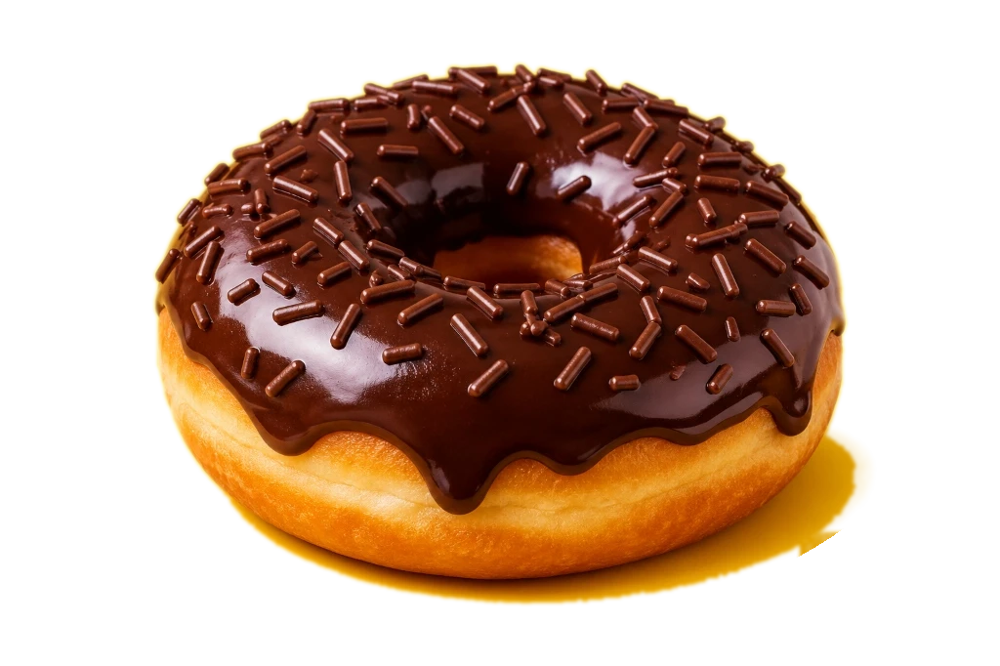

# 🍩 GLAZE & CO. — Premium Donut Shop Website

A modern, visually immersive, and responsive artisan donut shop website built with Next.js App Router, GSAP ScrollTrigger, Lenis smooth scrolling, and an interactive 360° WebP donut sequence.



---

## ✨ Features

- **Interactive 360° Donut Experience:** Scroll-driven and touch/drag 3D rotation of the signature glazed donut with transparent alpha background and zero watermarks.
- **Dynamic 5-Stage Flavour Showcase:** Smooth scroll and tap transitions across 5 signature donuts:
  1. *Chocolate Glazed* (₹80)
  2. *Strawberry Sprinkle* (₹90)
  3. *Oreo Crunch* (₹110)
  4. *Caramel Crunch* (₹100)
  5. *White Choco* (₹120)
- **Delightful Loading Screen:** Animated SVG donut with dripping strawberry glaze progress, colorful sprinkles, brand title, and percentage counter (0% → 100%).
- **Mobile Responsive Design:**
  - Compact vertical hero stack with drag-to-rotate touch controls.
  - Interactive flavour bar and responsive product grid.
  - Touch-friendly slide-over shopping bag drawer.
- **Artisan Product Cards:** Designed to match the brand reference mockup with rounded white cards (`border-radius: 36px`), overlapping donut imagery, soft drop shadows, INR (₹) pricing, and strawberry-pink action buttons.
- **Interactive E-Commerce Shopping Bag:**
  - React Context API with `localStorage` persistence.
  - Item counter, increment/decrement, remove item.
  - Free express delivery progress bar (threshold: ₹300).
  - Promo code system (`DONUTLOVE` for 15% off).
  - Subtotal and total calculation in INR.
  - Checkout celebration feedback state.
- **Bakery & Beverage Menus:**
  - *Other Treats:* Chocolate Brownie, Blueberry Muffin, Chocolate Cupcake, Cinnamon Roll, Chocolate Croissant, Mini Donut Box (6 pcs).
  - *Beverages:* Hot Coffee, Cold Coffee, Chocolate Milkshake, Strawberry Milkshake, Iced Latte.
- **Editorial Brand Story:** *"MADE FRESH. MADE WITH LOVE."* featuring 24-hour slow brioche fermentation and 3 core craft pillars.

---

## 🛠️ Technology Stack

- **Framework:** Next.js 14 (App Router)
- **Language:** JavaScript & JSX (No TypeScript)
- **Animations:** GSAP & GSAP ScrollTrigger
- **Smooth Scrolling:** Lenis (`lenis`)
- **Icons:** Lucide React (`lucide-react`)
- **Styling:** CSS Modules & Clean CSS Variables (`app/globals.css`)
- **Optimization:** WebP image sequence (30 FPS, transparent RGBA)

---

## 🚀 Getting Started

### Prerequisites

- Node.js 18+ (tested on Node 20 / 22 / 24)
- npm or yarn

### Installation

```bash
# Clone the repository
git clone https://github.com/Shamil2k7/glaze-co.git
cd glaze-co

# Install dependencies
npm install

# Run the local development server
npm run dev
```

Open [http://localhost:3000](http://localhost:3000) in your browser.

---

## ⚡ Deploying to Vercel

1. Push your repository to GitHub:
   ```bash
   git push -u origin main
   ```
2. Go to [Vercel](https://vercel.com) and click **"Add New Project"**.
3. Import the `glaze-co` repository.
4. Framework Preset will be automatically detected as **Next.js**.
5. Click **"Deploy"**. Your site will be live globally in under 60 seconds!

---

## 📂 Project Structure

```
glaze-co/
├── app/
│   ├── layout.jsx           # Root layout, fonts, metadata & providers
│   ├── page.jsx             # Home page assembling all sections
│   └── globals.css          # Design system & CSS rules
├── components/
│   ├── Navbar.jsx           # Wordmark logo, links & active cart badge
│   ├── HeroSection.jsx      # GSAP ScrollTrigger desktop & mobile hero
│   ├── DonutSequence.jsx    # Transparent canvas sequence & touch drag
│   ├── LoadingScreen.jsx    # Animated SVG donut loading screen
│   ├── StorySection.jsx     # Editorial brand story & pillars
│   ├── FeaturedDonuts.jsx   # 5 Signature donut cards
│   ├── OtherTreats.jsx      # Bakery treats cards
│   ├── Beverages.jsx        # Specialty drinks cards
│   ├── ProductCard.jsx      # Reference-matched white product card
│   ├── CartDrawer.jsx       # Slide-out bag with checkout flow
│   ├── ToastNotification.jsx# Add-to-bag toast alerts
│   ├── SmoothScroll.jsx     # Lenis smooth momentum scrolling
│   └── Footer.jsx           # Dark chocolate brown footer
├── context/
│   └── CartContext.jsx      # React Context for shopping cart state
├── data/
│   └── products.js          # Product data, prices in INR, & hero stages
├── hooks/
│   └── useDonutSequence.js  # Sequence preloading hook
└── public/assets/
    ├── donuts/              # 5 High-res reference donuts
    ├── treats/              # Bakery food photography
    ├── beverages/           # Drinks photography
    └── donut-sequence/      # 94 Extracted WebP frames
```

---

## 📄 License

MIT © [GLAZE & CO.](https://github.com/Shamil2k7/glaze-co)
